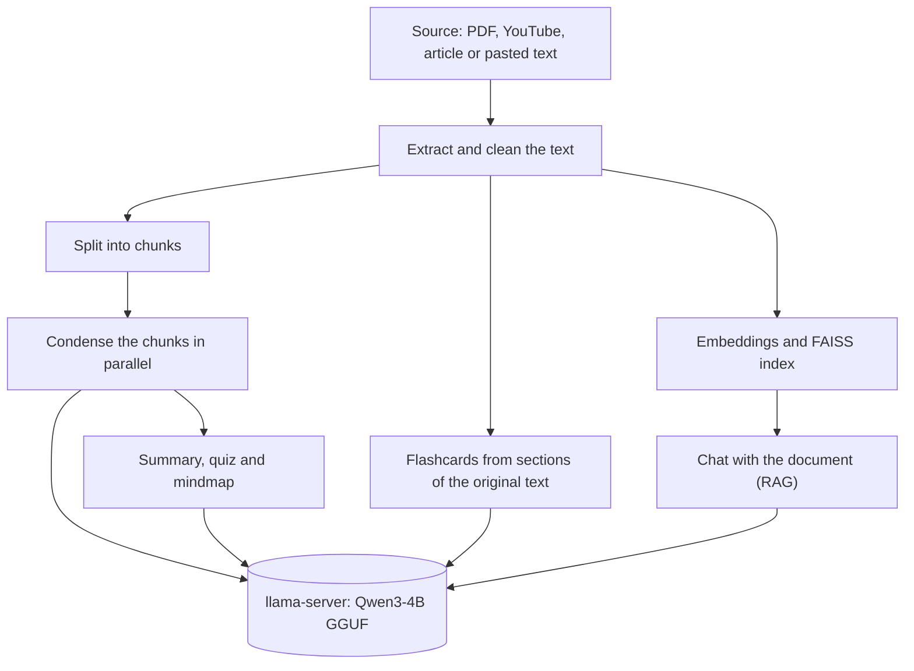

# StudyForge

**Turn PDFs, YouTube videos and articles into summaries, flashcards, quizzes and mindmaps,
and chat with them using RAG. Runs locally with an open model.**

Give StudyForge a PDF, a YouTube link, a web article or pasted text. It writes study
material for you and lets you ask questions that are answered from the original text.
Everything runs on your own computer, so your documents are not sent to a cloud AI service.


<!-- Add screenshots to a docs/ folder, then remove the comment markers:


-->

## Features

- **Four ways to add material:** upload a PDF, paste a YouTube link, paste an article link,
  or paste the text itself.
- **Summaries** in several styles, at the length you choose.
- **Flashcards** in any number. Each batch is written from a different part of the
  document, and repeated or malformed cards are dropped.
- **Quizzes** with multiple-choice questions, explanations and scoring.
- **Mindmaps** of the main ideas.
- **Chat with your document (RAG):** questions are answered from the original text, the
  passages used are shown below each answer, and the reply streams in as it is written.
- **Handy details:** live progress for every task, a cancel button, saved results so
  nothing is processed twice, and a button that shuts the app and the model down.

## How it works



- **Interface:** Streamlit (`streamlit_app.py`).
- **Model:** Qwen3-4B-Instruct-2507 as a 4-bit GGUF file, served by llama.cpp's
  `llama-server`. The app downloads it and starts it for you.
- **Retrieval:** `all-MiniLM-L6-v2` embeddings and a FAISS index, run on the CPU.
- **YouTube:** uses English captions, or asks YouTube to translate other captions to
  English. Videos with neither are rejected with a clear message.

## Requirements

| | |
|---|---|
| Operating system | Windows 10 or 11 |
| GPU | NVIDIA, 4 GB of memory or more (developed on an RTX 3050 with 4 GB) |
| Python | 3.11 |
| First run | Internet access: about 1 GB for llama.cpp and about 2.5 GB for the model, downloaded once |

Windows **Smart App Control must be off**. It blocks `llama-server` because the program is
not code-signed.

## Quick start

```
git clone https://github.com/type-your-real-github-username-here/studyforge.git
cd studyforge
python -m venv .venv
.venv\Scripts\activate
pip install -r requirements.txt
streamlit run streamlit_app.py
```

Open the address Streamlit prints, pick a source, press **Process**, then use the tabs.
The first start takes longer while llama.cpp and the model download.

## Settings

Everything adjustable is in `src/config.py`.

| Setting | Default | What it does |
|---|---|---|
| `SERVER_SLOTS` | 2 | Requests the model handles at the same time |
| `SERVER_CTX_PER_SLOT` | 4096 | Context window per slot, in tokens |
| `CONDENSE_TARGET_TOKENS` | about 2,400 | Size of the condensed text. It follows the context size, so a bigger context keeps more detail but processing is slower |
| `RAG_TOP_K` | 4 | Passages retrieved for each question |
| `GGUF_PATH` | empty | Path to your own GGUF model file |

## Project layout

```
streamlit_app.py        the web app
app.py                  optional terminal version
src/
  config.py             settings
  pipelines.py          PDF, YouTube, article and text processing, with caching
  processor.py          condenses long text
  llm.py                talks to the model
  llm_server.py         HTTP client for llama-server
  server_manager.py     downloads, starts and stops llama-server
  summarizer.py  flashcards.py  mindmap.py  prompt.py
  quiz/                 quiz generation and scoring
  rag/                  chunking, embeddings, FAISS index, question answering
  youtube/  web/        transcript and article loading
```

## Known limits

- Quizzes, long summaries and mindmaps are built from the condensed text, so a long
  document is covered at a high level rather than in fine detail.
- Processing a long video takes a few minutes the first time. Results are saved.
- Some news sites build their pages in the browser and block automated downloads. For
  those, copy the article text and use **Pasted Text**.
- The model is small. Check important facts against the source.

## Troubleshooting

| Problem | What to try |
|---|---|
| "Couldn't start the model server" | Read `llama_server.log`. Check that Smart App Control is off and that nothing else is using the GPU. |
| Out of GPU memory | Set `SERVER_SLOTS = 1` in `src/config.py`. |
| "Failed to extract article" | Use **Pasted Text** instead. |

## Credits

Built on [llama.cpp](https://github.com/ggml-org/llama.cpp), the Qwen3 models from Alibaba
Cloud, [sentence-transformers](https://www.sbert.net/), [FAISS](https://github.com/facebookresearch/faiss)
and [Streamlit](https://streamlit.io/).

<!-- Add a LICENSE file and mention it here, for example: Released under the MIT License. -->
